# Hi 👋 I'm Gideon!
I'm a software engineering student from the Netherlands, studying at Hanze University of Applied Sciences in Groningen. Alongside my studies, I work as a PHP developer at Dotsimpel, where I apply my skills in the real world. I'm also actively exploring the world of software development and engineering through personal projects and by connecting with new people.

My interest in programming started at age 11, when I began creating simple games in Unity. A few years later, I started building my own Discord bot. That's when it clicked! I knew I wanted to turn my passion into a career.

## Experienced with...
Languages, frameworks, software and more.

  
  <a href="https://gideontigelaar.com" style="text-decoration: none;">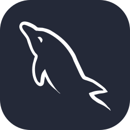</a>
  <a href="https://gideontigelaar.com" style="text-decoration: none;">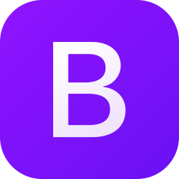</a>
  <a href="https://gideontigelaar.com" style="text-decoration: none;">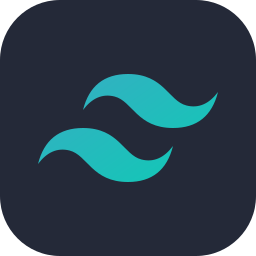</a>
  <a href="https://gideontigelaar.com" style="text-decoration: none;">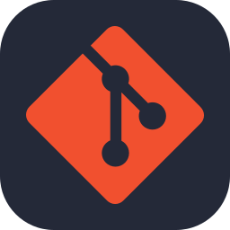</a>
   
  <a href="https://gideontigelaar.com" style="text-decoration: none;">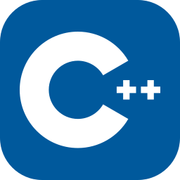</a>
  <a href="https://gideontigelaar.com" style="text-decoration: none;">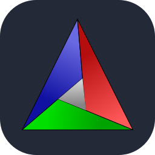</a>
  <a href="https://gideontigelaar.com" style="text-decoration: none;">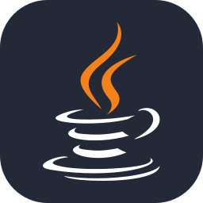</a>
  <a href="https://gideontigelaar.com" style="text-decoration: none;">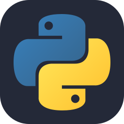</a>
  <a href="https://gideontigelaar.com" style="text-decoration: none;">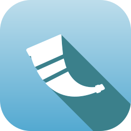</a>
   
  <a href="https://gideontigelaar.com" style="text-decoration: none;">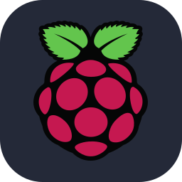</a>
  <a href="https://gideontigelaar.com" style="text-decoration: none;">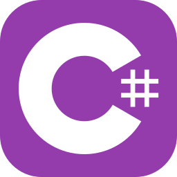</a>
  <a href="https://gideontigelaar.com" style="text-decoration: none;">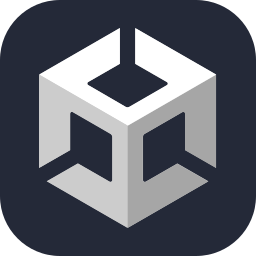</a>
  <a href="https://gideontigelaar.com" style="text-decoration: none;">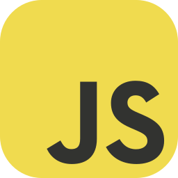</a>
  <a href="https://gideontigelaar.com" style="text-decoration: none;">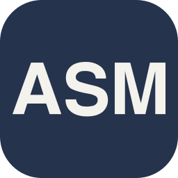</a>

